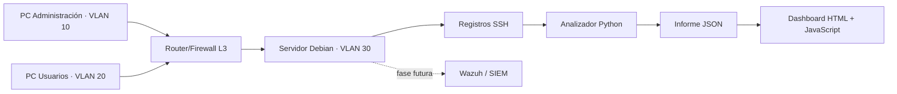

# SentinelLab ASIR · Laboratorio de infraestructura y detección (Blue Team)

**Autor:** Alejandro Oliach Andreu  
**Estado:** versión inicial funcional (análisis SSH + dashboard) · redes y SIEM por implementar  
**Objetivo:** demostrar conocimientos de ASIR y el interés profesional en ciberseguridad en un entorno aislado y autorizado.

## ¿Qué incluye esta primera versión?

- **Python 3**: analizador de registros SSH con detección de intentos fallidos repetidos en ventana temporal y de accesos correctos tras fallos.
- **Pruebas automatizadas**: tests unitarios con `unittest`.
- **Desarrollo web**: panel HTML, CSS y JavaScript que presenta las alertas de un informe JSON.
- **Datos sintéticos**: direcciones IP reservadas para documentación, sin información de usuarios reales.
- **Documentación**: diseño de infraestructura, laboratorio Cisco Packet Tracer, hardening Linux, registro de evidencias y plantilla Notion.

> La parte de redes, los servidores virtuales y el SIEM están **planificados, no implementados**. No presentar estas fases como completadas hasta generar las evidencias correspondientes.

## Inicio rápido — Windows / Linux / macOS

Necesitas Python 3.10 o posterior. No hay librerías externas que instalar. Sitúate en la carpeta del repositorio.

```bash
python scripts/analyze_auth.py --input data/sample_auth.log --output docs/dashboard/report.json
python -m unittest discover -s tests -v
python -m http.server 8000 --directory docs/dashboard
```

Abre <http://localhost:8000/> en el navegador. En algunas instalaciones Linux el ejecutable se llama `python3`, no `python`.

Resultado esperado con los datos de ejemplo: **10 eventos SSH, 8 fallos, 2 accesos correctos y 2 alertas**. La muestra también contiene una línea `cron` ignorada.

## Arquitectura prevista



## Fases de construcción

| Fase | Entregable | Estado | Competencias |
|---|---|---|---|
| 1 | Parser SSH, detecciones, pruebas y dashboard | **Inicial funcional** | Python, HTML, JavaScript, troubleshooting |
| 2 | VLAN, direccionamiento IP, ACL y topología Packet Tracer | Completado y terminado | Cisco, routing, switching |
| 3 | Servidor Debian/Ubuntu, SSH seguro, UFW, usuarios y backups | Pendiente | Linux, hardening |
| 4 | Integración centralizada de registros y Wazuh | Pendiente | Blue Team, SIEM, monitorización |
| 5 | Incidentes simulados autorizados, capturas y análisis técnico | Pendiente | Detección, documentación, respuesta |

## Cómo documentar resultados

1. Mantén un `CHANGELOG` de las mejoras relevantes.
2. Guarda capturas **sin secretos ni direcciones/IP reales** en `docs/evidencias/`.
3. Describe **objetivo, procedimiento, resultado observado y aprendizaje** de cada prueba.
4. Publica una página Notion usando `docs/notion-portfolio.md`.
5. Vincula el repositorio y la página Notion en el CV **una vez completadas las fases demostrables**.

## Buenas prácticas

Este repositorio es educativo y defensivo. Usa únicamente sistemas propios o autorizados. Evita publicar contraseñas, tokens, datos personales o logs de producción. Las reglas de detección son didácticas y no sustituyen un SIEM real.

## Mejoras sugeridas

- Ingesta de logs de `journalctl`/`auth.log` tras anonimización y adaptación de formatos.
- Detección de múltiples nombres de usuario desde una sola IP.
- Almacenamiento SQLite de eventos y panel histórico.
- Integración de alertas con Wazuh en una VM.
- Laboratorios de red reproducibles en Packet Tracer y diagramas.

## Fase 2 · Cisco Network Security — Completada

He implementado y validado en Cisco Packet Tracer una topología segmentada en VLAN 10 (gestión), VLAN 20 (usuarios) y VLAN 30 (servidores). He configurado switching, trunk 802.1Q y Router-on-a-Stick en Cisco IOS, y he aplicado una ACL extendida para controlar el tráfico entre las redes.

**Resultado:** PC-USER puede acceder por HTTP al servidor de VLAN 30, pero tiene bloqueados los pings a PC-ADMIN y a WEB-SRV. PC-ADMIN conserva conectividad con el servidor.

**Habilidades demostradas:** VLAN, CCNA, routing inter-VLAN, ACL extendidas, TCP/IP, ICMP, troubleshooting y pruebas de controles de acceso.

[Ver el caso práctico Cisco y sus evidencias](docs/packet-tracer/README.md)

---