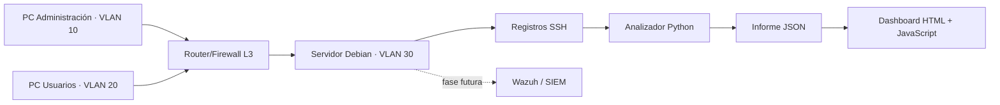

# SentinelLab ASIR · Laboratorio de infraestructura y detección (Blue Team)

- **Autor:** Alejandro Oliach Andreu
- **Estado:** fase 1 (analizador SSH y dashboard) funcional; fase 2 (redes en Cisco Packet Tracer) completada. Fases 3–5 pendientes.
- **Objetivo:** demostrar conocimientos de ASIR y el interés profesional en ciberseguridad en un entorno aislado y autorizado.

## ¿Qué está implementado actualmente?

- **Python 3**: analizador de registros SSH con detección de intentos fallidos repetidos en ventana temporal y de accesos correctos tras fallos.
- **Pruebas automatizadas**: tests unitarios con `unittest`.
- **Desarrollo web**: panel HTML, CSS y JavaScript que presenta las alertas de un informe JSON.
- **Datos sintéticos**: direcciones IP reservadas para documentación, sin información de usuarios reales.
- **Redes en Cisco Packet Tracer**: topología con tres VLAN, routing inter-VLAN y ACL extendida; se incluyen archivos `.pkt`, configuraciones y capturas de las pruebas.
- **Documentación**: diseño de infraestructura, [caso práctico Cisco](docs/packet-tracer/README.md), plantillas de evidencias y portfolio. La guía de hardening Linux describe una fase futura.

> **Alcance actual:** el analizador SSH funciona con registros sintéticos y la red de la fase 2 está implementada **en Cisco Packet Tracer**. Son dos prácticas independientes por ahora: no hay integración entre el analizador y la red simulada. El servidor Linux real o virtual, su hardening, el SIEM Wazuh y las pruebas integradas de incidentes **siguen pendientes**.

## Inicio rápido — Windows / Linux / macOS

Necesitas Python 3.10 o posterior. No hay librerías externas que instalar. Sitúate en la carpeta del repositorio.

```bash
python scripts/analyze_auth.py --input data/sample_auth.log --output docs/dashboard/report.json
python -m unittest discover -s tests -v
python -m http.server 8000 --directory docs/dashboard
```

Abre <http://localhost:8000/> en el navegador. En algunas instalaciones Linux el ejecutable se llama `python3`, no `python`.

Resultado esperado con los datos de ejemplo: **10 eventos SSH, 8 fallos, 2 accesos correctos y 2 alertas**. La muestra también contiene una línea `cron` ignorada.

## Parser SSH: formatos soportados y validación

El analizador reconoce mensajes `Failed password`, `Accepted password`,
`Failed publickey` y `Accepted publickey`, con identificador de proceso
`sshd[PID]:` y fecha ISO 8601 con zona horaria.

Cada evento conserva el método de autenticación en `auth_method`.
Las direcciones se validan con `ipaddress` y se normalizan, incluido IPv6.
El patrón admite un sufijo opcional con detalles de la clave; no verifica
criptográficamente su contenido.

El informe JSON incluye una sección `parsing`:

| Campo | Significado |
|---|---|
| `total_lines` | Total de líneas leídas |
| `parsed_events` | Eventos interpretados correctamente |
| `non_ssh_lines` | Líneas sin el identificador `sshd[PID]:` reconocido |
| `unparsed_ssh_lines` | Líneas con ese identificador que no se pudieron interpretar |

Una línea SSH no interpretada puede contener un mensaje no soportado
o datos inválidos. No implica por sí sola actividad maliciosa.

### Validación realizada

- Trece pruebas unitarias ejecutadas correctamente.
- Casos añadidos: acceso por clave pública, conservación del método
  password, IP inválida, normalización IPv6, fecha imposible,
  ausencia de zona horaria y contadores de parsing.
- Ejecución completa con `data/sample_auth.log`: 11 líneas leídas,
  10 eventos interpretados, 1 línea sin el identificador SSH reconocido
  y 0 líneas SSH sin interpretar.
- Resultado de la muestra: 8 fallos, 2 accesos correctos y 2 alertas.

### Limitaciones actuales

La validación utiliza registros sintéticos. Todavía no se ha comprobado
la compatibilidad con registros obtenidos de una VM Linux.

No se soporta el formato syslog tradicional sin año y zona horaria,
ni la salida JSON de journalctl. Otros identificadores de proceso
pueden clasificarse como `non_ssh_lines`.

El campo `auth_method` se conserva en los eventos internos; todavía
no se presenta en las alertas ni en el dashboard.

## Arquitectura objetivo (aún no integrada)

El siguiente diagrama representa la arquitectura que se pretende construir por fases. No describe un entorno completo ya desplegado: la topología de las VLAN se ha validado en Packet Tracer y el analizador SSH se ha probado por separado con datos sintéticos.



## Fases de construcción

| Fase | Entregable | Estado | Competencias |
|---|---|---|---|
| 1 | Parser SSH, detecciones, pruebas y dashboard | **Inicial funcional** | Python, HTML, JavaScript, troubleshooting |
| 2 | VLAN, direccionamiento IP, ACL y topología Packet Tracer | **Completada en simulación** | Cisco IOS, routing, switching |
| 3 | Servidor Debian/Ubuntu, SSH seguro, UFW, usuarios y backups | Pendiente | Linux, hardening |
| 4 | Integración centralizada de registros y Wazuh | Pendiente | Blue Team, SIEM, monitorización |
| 5 | Incidentes simulados autorizados, capturas y análisis técnico | Pendiente | Detección, documentación, respuesta |

## Cómo documentar resultados

1. Mantén un `CHANGELOG` de las mejoras relevantes.
2. Guarda capturas **sin secretos ni direcciones/IP reales** en `docs/evidencias/`.
3. Describe **objetivo, procedimiento, resultado observado y aprendizaje** de cada prueba.
4. Publica una página Notion usando `docs/notion-portfolio.md`.
5. Vincula el repositorio y la página Notion en el CV **una vez completadas las fases demostrables**.

## Buenas prácticas

Este repositorio es educativo y defensivo. Usa únicamente sistemas propios o autorizados. Evita publicar contraseñas, tokens, datos personales o logs de producción. Las reglas de detección son didácticas y no sustituyen un SIEM real.

## Mejoras sugeridas

- Ingesta de logs de `journalctl`/`auth.log` tras anonimización y adaptación de formatos.
- Detección de múltiples nombres de usuario desde una sola IP.
- Almacenamiento SQLite de eventos y panel histórico.
- Integración de alertas con Wazuh en una VM.
- Ampliar el laboratorio de Packet Tracer con nuevos escenarios y pruebas documentadas.

## Fase 2 · Cisco Network Security — Completada

He implementado y validado en Cisco Packet Tracer una topología segmentada en VLAN 10 (gestión), VLAN 20 (usuarios) y VLAN 30 (servidores). He configurado switching, trunk 802.1Q y Router-on-a-Stick en Cisco IOS, y he aplicado una ACL extendida para controlar el tráfico entre las redes.

**Resultado:** PC-USER puede acceder por HTTP al servidor de VLAN 30, pero tiene bloqueados los pings a PC-ADMIN y a WEB-SRV. PC-ADMIN conserva conectividad con el servidor.

**Habilidades demostradas:** configuración de VLAN, routing inter-VLAN, ACL extendidas, TCP/IP, ICMP, troubleshooting y pruebas de controles de acceso.

[Ver el caso práctico Cisco y sus evidencias](docs/packet-tracer/README.md)

---
