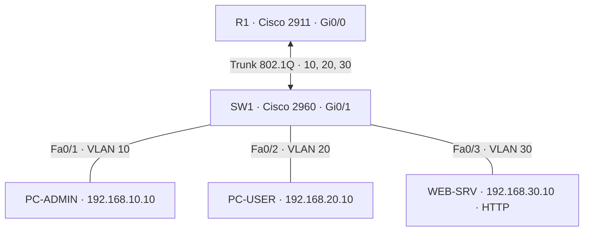

# SentinelLab ASIR · Fase 2: VLAN, routing y ACL en Cisco Packet Tracer

**Estado:** guía y configuración de referencia creadas; implementación y validación en Packet Tracer pendientes. **No se incluye un archivo `.pkt`**: debe guardarse desde Cisco Packet Tracer tras construir la topología.

## Objetivo

Simular la segmentación de una red corporativa pequeña mediante tres VLAN, un router Cisco 2911, un switch Cisco 2960-24TT, dos PC y un servidor HTTP. Implementar una política de mínimo privilegio para usuarios con una ACL extendida de IOS.

## Diagrama



## Plan de direccionamiento

| Equipo/interfaz | VLAN | Dirección | Máscara | Puerta de enlace |
|---|---:|---|---|---|
| R1 Gi0/0.10 | 10 | 192.168.10.1 | 255.255.255.0 | — |
| R1 Gi0/0.20 | 20 | 192.168.20.1 | 255.255.255.0 | — |
| R1 Gi0/0.30 | 30 | 192.168.30.1 | 255.255.255.0 | — |
| SW1 VLAN 10 (gestión) | 10 | 192.168.10.2 | 255.255.255.0 | 192.168.10.1 |
| PC-ADMIN | 10 | 192.168.10.10 | 255.255.255.0 | 192.168.10.1 |
| PC-USER | 20 | 192.168.20.10 | 255.255.255.0 | 192.168.20.1 |
| WEB-SRV | 30 | 192.168.30.10 | 255.255.255.0 | 192.168.30.1 |

## Construcción en Packet Tracer

1. Arrastra **Router 2911**, **Switch 2960-24TT**, **2 PC-PT** y **1 Server-PT** al espacio de trabajo.
2. Renombra cada dispositivo: **R1**, **SW1**, **PC-ADMIN**, **PC-USER**, **WEB-SRV**.
3. Conecta con *Copper Straight-Through*:
   - R1 `Gi0/0` ↔ SW1 `Gi0/1`.
   - PC-ADMIN `Fa0` ↔ SW1 `Fa0/1`.
   - PC-USER `Fa0` ↔ SW1 `Fa0/2`.
   - WEB-SRV `Fa0` ↔ SW1 `Fa0/3`.
4. En CLI de SW1, configura el contenido de `SW1-config.txt`, preferiblemente por bloques. Confirma que no aparecen errores de sintaxis.
5. En CLI de R1, configura el contenido de `R1-config.txt`, preferiblemente por bloques. La ACL se aplica **in** en `Gi0/0.20`.
6. En cada PC-PT, entra en **Desktop → IP Configuration** y rellena la dirección IPv4 estática, máscara y gateway de la tabla.
7. En WEB-SRV, entra en **Desktop → IP Configuration** para su IP y en **Services → HTTP** deja el servicio **On**.
8. Guarda el trabajo como `SentinelLab-Fase2.pkt` en esta carpeta (este archivo lo genera Packet Tracer).

**Si cambian los nombres de interfaces según el modelo de hardware usado**, adapta los comandos y documenta el cambio.

## ACL: interpretación de mínimo privilegio

La ACL de `Gi0/0.20` permite al segmento USUARIOS hacer ping a su **propio** gateway y acceder a **HTTP TCP/80** del servidor. Deniega el resto del tráfico IP dirigido a redes de gestión, servidores y cualquier otro destino. **No permite DNS, HTTPS, Internet ni SSH desde usuarios**; añadir estas excepciones solo si se justifican en una mejora posterior.

Esta ACL es **sin estado**: una solicitud desde GESTIÓN hacia USUARIOS podría no recibir respuesta por la ACL de retorno, aunque no haya ACL aplicada a la interfaz de gestión. El experimento principal usa las pruebas de la sección siguiente.

## Pruebas que debes ejecutar y documentar

| Origen | Destino / comando | Resultado esperado | Motivo |
|---|---|---|---|
| PC-USER | `ping 192.168.20.1` | **Éxito** | Gateway propio; ICMP permitido |
| PC-USER | `ping 192.168.10.10` | **Fallo** | Red de gestión bloqueada |
| PC-USER | `ping 192.168.30.10` | **Fallo** | ICMP hacia servidores no autorizado |
| PC-USER | navegador `http://192.168.30.10` | **Éxito** | HTTP al único servidor permitido |
| PC-ADMIN | `ping 192.168.30.10` | **Éxito** | Sin ACL bloqueando el tráfico desde GESTIÓN |
| PC-ADMIN | `ping 192.168.10.2` | **Éxito** | Administración del switch en VLAN 10 |

Si un primer ping falla, repítelo tras resolver ARP. Si todos los pings fallan, revisa puertos conectados, IPs, VLAN y trunk **antes** de depurar la ACL.

## Comandos de diagnóstico

### En SW1

```
show vlan brief
show interfaces trunk
show ip interface brief
show running-config
```

### En R1

```
show ip interface brief
show ip route
show access-lists
show ip interface GigabitEthernet0/0.20
show running-config
```

## Evidencias para portfolio

- Captura A: topología completa, nombre de equipos y VLAN.
- Captura B: `show vlan brief` y `show interfaces trunk` de SW1.
- Captura C: `show ip interface brief` de R1.
- Captura D: navegador de PC-USER mostrando el HTTP de WEB-SRV.
- Captura E: ping denegado desde PC-USER a PC-ADMIN.
- Captura F: `show access-lists` con contadores de coincidencias (si Packet Tracer los muestra).
- Captura G: modo **Simulation** con el paquete que pasa o se descarta por la ACL.

> En GitHub, guarda `.pkt`, configuraciones `.txt`, fotos/diagramas y anotaciones. **No marques esta fase como implementada** hasta completar y verificar las pruebas. Las capturas deben reflejar el resultado real, no un resultado supuesto.

## Próxima iteración

Aplicar hardening básico en el switch/router, agregar DNS o HTTPS mediante excepciones específicas de ACL, y preparar transición del servidor simulado a una VM Linux para integrar registros SSH y SentinelLab.
