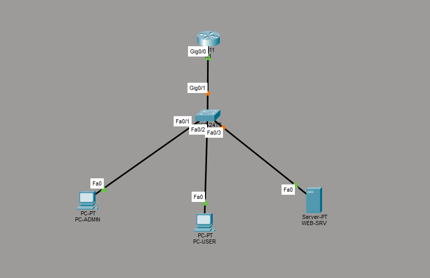
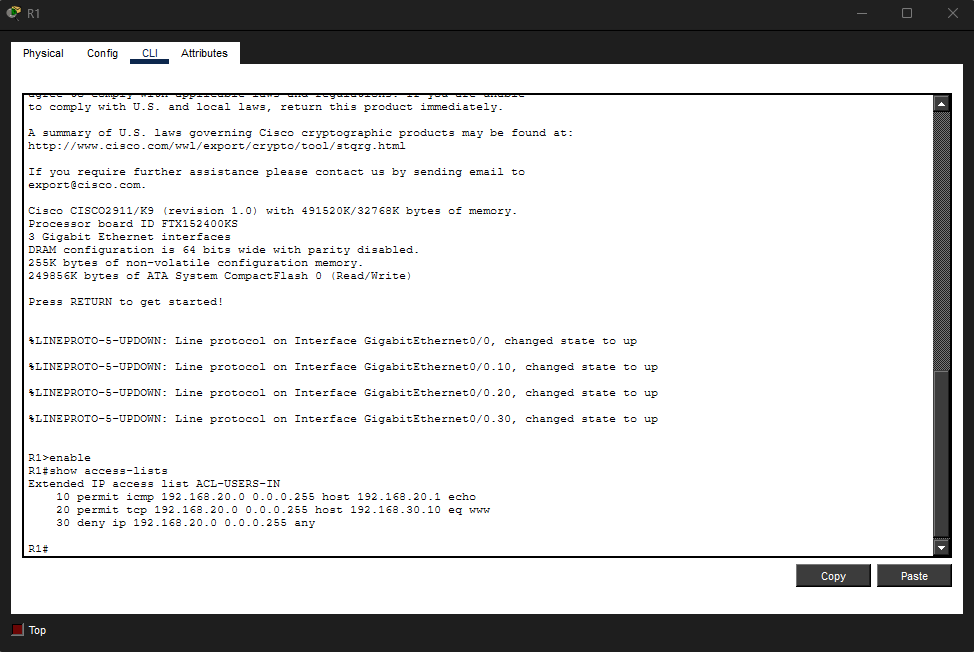
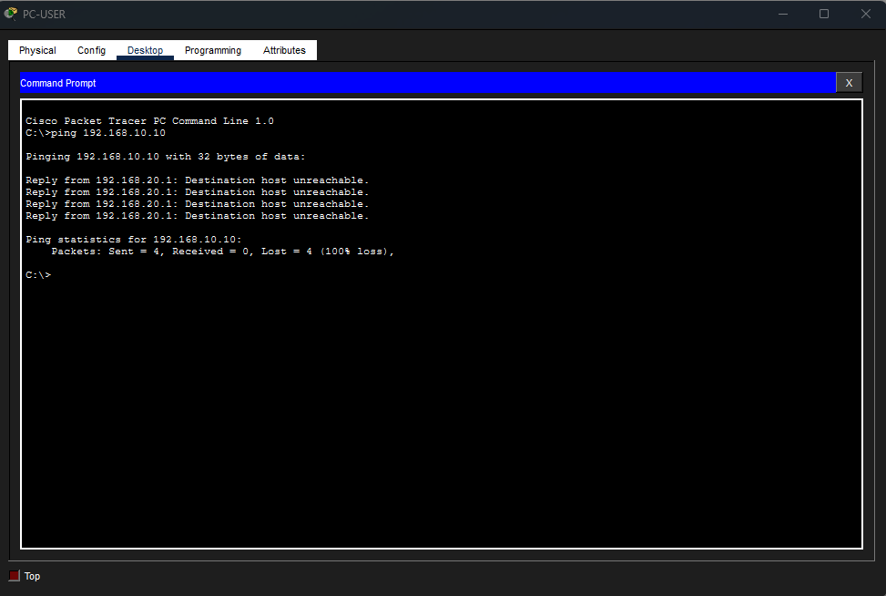
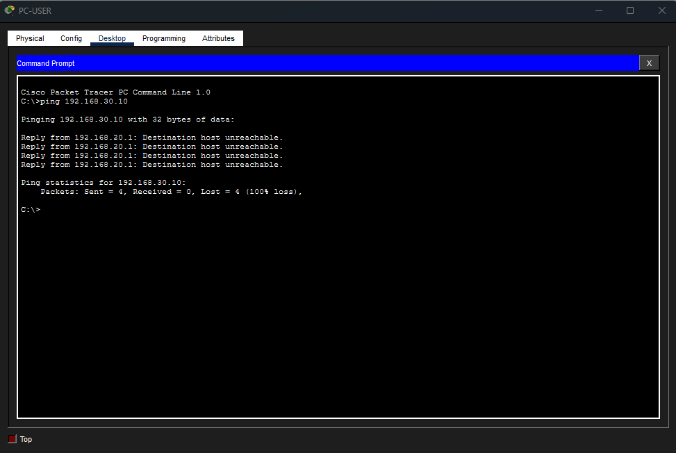
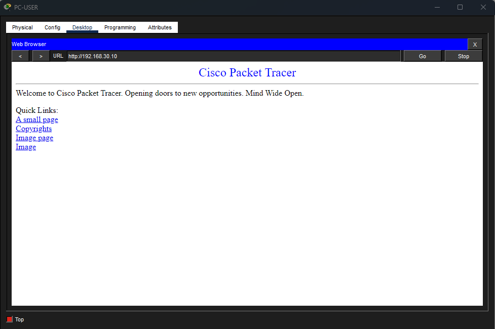

# SentinelLab-ASIR | Cisco Network Segmentation & ACL Security

**Estado:** implementado y validado en Cisco Packet Tracer  
**Tipo:** laboratorio educativo de redes y ciberseguridad defensiva  
**Tecnologías:** Cisco IOS · VLAN · Trunk 802.1Q · Router-on-a-Stick · IPv4 · ACL extendidas · ICMP · HTTP · ARP · STP

**Alcance:** esta es la **fase 2** de SentinelLab-ASIR, completada en un entorno simulado de Cisco Packet Tracer. No incluye todavía el despliegue de un servidor Linux, la integración con el analizador SSH ni un SIEM; esas fases siguen pendientes. Consulta el [estado general del proyecto](../../README.md).

## 1. Objetivo del proyecto

Diseñar una red empresarial de laboratorio segmentada en **tres VLAN** y aplicar el principio de **mínimo privilegio** con una lista de control de acceso (ACL) extendida.

El objetivo de la práctica es comprobar que **separar dispositivos en VLAN no impide por sí solo la comunicación entre redes** cuando existe routing inter-VLAN. Para reforzar la seguridad, se configura una ACL que permite a la red de usuarios acceder al servicio HTTP autorizado, pero bloquea el acceso no autorizado a la red de administración y el tráfico ICMP hacia el servidor.

## 2. Topología de red



**Equipamiento simulado:**

- **R1:** router Cisco 2911; puerta de enlace y routing inter-VLAN.
- **SW1:** switch Cisco 2960; segmentación VLAN y enlace trunk.
- **PC-ADMIN:** equipo de administración de la VLAN 10.
- **PC-USER:** equipo de usuario de la VLAN 20.
- **WEB-SRV:** servidor HTTP de la VLAN 30.

**Conexiones principales:**

| Origen | Interfaz | Destino | Interfaz | Función |
|---|---|---|---|---|
| R1 | Gi0/0 | SW1 | Gi0/1 | Trunk 802.1Q |
| PC-ADMIN | Fa0 | SW1 | Fa0/1 | Puerto access, VLAN 10 |
| PC-USER | Fa0 | SW1 | Fa0/2 | Puerto access, VLAN 20 |
| WEB-SRV | Fa0 | SW1 | Fa0/3 | Puerto access, VLAN 30 |

## 3. VLAN y direccionamiento IPv4

| VLAN | Nombre | Red IPv4 | Gateway | Dispositivo y dirección |
|---|---|---|---|---|
| 10 | MANAGEMENT | `192.168.10.0/24` | `192.168.10.1` | PC-ADMIN: `192.168.10.10` |
| 20 | USERS | `192.168.20.0/24` | `192.168.20.1` | PC-USER: `192.168.20.10` |
| 30 | SERVERS | `192.168.30.0/24` | `192.168.30.1` | WEB-SRV: `192.168.30.10` |

**Máscara utilizada:** `255.255.255.0` para las tres redes. El servidor proporciona HTTP mediante **TCP/80**.

## 4. Implementación técnica

### Segmentación en SW1

1. Creación de las VLAN **10**, **20** y **30**.
2. Asignación de `Fa0/1`, `Fa0/2` y `Fa0/3` como puertos de acceso de las VLAN correspondientes.
3. Configuración de `Gi0/1` como trunk **802.1Q**, permitiendo exclusivamente las VLAN `10,20,30`.
4. Verificación mediante `show vlan brief`, `show interfaces trunk` y `show spanning-tree vlan 10`.

### Routing inter-VLAN en R1

Se utiliza **Router-on-a-Stick**, con una subinterfaz por VLAN en el enlace físico `Gi0/0`:

| Subinterfaz | Etiqueta 802.1Q | IP del gateway |
|---|---|---|
| `Gi0/0.10` | 10 | `192.168.10.1/24` |
| `Gi0/0.20` | 20 | `192.168.20.1/24` |
| `Gi0/0.30` | 30 | `192.168.30.1/24` |

Se comprobó que `Gi0/0` y sus tres subinterfaces estaban en estado **up/up** mediante `show ip interface brief`.

## 5. Política de seguridad: ACL extendida

La ACL `ACL-USERS-IN` se aplica **en entrada (`in`)** sobre `GigabitEthernet0/0.20` del router. Filtra el tráfico procedente de la VLAN de usuarios antes de su enrutamiento.

```cisco
ip access-list extended ACL-USERS-IN
 remark Allow ICMP to VLAN 20 gateway
 permit icmp 192.168.20.0 0.0.0.255 host 192.168.20.1 echo
 remark Allow HTTP access to web server
 permit tcp 192.168.20.0 0.0.0.255 host 192.168.30.10 eq 80
 remark Deny all other routed traffic from VLAN 20
 deny ip 192.168.20.0 0.0.0.255 any
!
interface GigabitEthernet0/0.20
 ip access-group ACL-USERS-IN in
```

**Interpretación de las reglas:**

- **Permitir:** ping desde la VLAN 20 a su propio gateway (`192.168.20.1`).
- **Permitir:** acceso HTTP desde la VLAN 20 al servidor `192.168.30.10`, puerto TCP 80.
- **Denegar:** el resto del tráfico IP procedente de la VLAN 20 que llegue al router para su procesamiento o enrutamiento.

### Evidencia: ACL en R1



> **Alcance:** una ACL de IOS es un filtro sin seguimiento del estado de las conexiones (*stateless*). Esta configuración no impide el tráfico entre equipos dentro de una misma VLAN y no sustituye a un firewall con inspección de estado.

## 6. Validación: antes y después de aplicar la ACL

Se verificó primero la conectividad entre las tres VLAN. Posteriormente se aplicó la ACL y se repitieron las pruebas para comprobar las restricciones.

| Origen | Destino / servicio | Antes de ACL | Después de ACL | Resultado esperado |
|---|---|---|---|---|
| PC-USER | Ping a `192.168.20.1` | Responde | Responde | **Permitido** |
| PC-USER | Ping a `192.168.10.10` | Responde | No responde | **Bloqueado** |
| PC-USER | Ping a `192.168.30.10` | Responde | No responde | **Bloqueado** |
| PC-USER | HTTP a `192.168.30.10` | Funciona | Funciona | **Permitido** |
| PC-ADMIN | Ping a `192.168.30.10` | Responde | Responde | **Permitido** |

**Resultado:** se cumplieron las condiciones previstas del laboratorio. La VLAN de usuarios conserva el acceso al servicio web autorizado sin poder utilizar ICMP para comunicarse con la red de administración ni con el servidor.

### Prueba 1 — Acceso a administración bloqueado

Ping desde **PC-USER** a **PC-ADMIN** (`192.168.10.10`): bloqueado después de aplicar la ACL.



### Prueba 2 — ICMP al servidor bloqueado

Ping desde **PC-USER** a **WEB-SRV** (`192.168.30.10`): bloqueado después de aplicar la ACL.



### Prueba 3 — HTTP permitido

El navegador de **PC-USER** puede abrir `http://192.168.30.10` después de aplicar la ACL. Esto confirma que la restricción es selectiva por servicio y no un bloqueo total del servidor.



## 7. Troubleshooting y aprendizajes

Durante el montaje se resolvieron varias incidencias:

- **Trunk no visible en `show interfaces trunk`:** se detectó que el router estaba apagado. Tras encenderlo, el enlace `Gi0/1` pasó a `trunking`.
- **STP inicialmente sin VLAN en forwarding:** al estabilizarse el enlace, el trunk mostró las VLAN `10,20,30` en forwarding.
- **Pérdida del primer paquete ICMP en algunas pruebas:** comportamiento compatible con la resolución inicial de direcciones MAC mediante **ARP**; los siguientes paquetes respondieron correctamente.
- **Separación de responsabilidades:** las VLAN se crean en el switch y las subinterfaces `802.1Q` del router proporcionan los gateways y el routing inter-VLAN.

## 8. Reproducir y verificar el laboratorio

1. Abrir el archivo `.pkt` de la versión final en **Cisco Packet Tracer**.
2. En **SW1**, ejecutar `show vlan brief` y `show interfaces trunk`.
3. En **R1**, ejecutar `show ip interface brief`, `show access-lists` y `show ip interface gigabitEthernet 0/0.20`.
4. En **PC-USER**, probar ICMP contra `192.168.20.1`, `192.168.10.10` y `192.168.30.10`.
5. Abrir `http://192.168.30.10` desde **PC-USER** y comprobar que el servidor responde.
6. Confirmar desde **PC-ADMIN** el ping permitido hacia `192.168.30.10`.

Los ficheros `.pkt` permiten abrir la topología en Packet Tracer, mientras que las capturas de `screenshots/` muestran las evidencias directamente en GitHub.

## 9. Mejoras previstas

- Hardening de dispositivos y administración segura de red.
- Integración futura con servidores Linux y monitorización de eventos.
- Publicación de un caso práctico visual en **Notion**, enlazado a este repositorio.

---

*Laboratorio educativo realizado en un entorno simulado y autorizado. Las configuraciones no deben publicarse con contraseñas ni otros secretos.*
