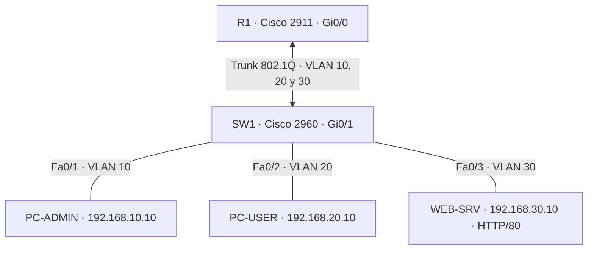

# SentinelLab-ASIR | Fase 2: Segmentación de red y seguridad con ACL

> **Estado:** implementación y pruebas realizadas en Cisco Packet Tracer. La topología `.pkt` y los resultados se obtuvieron en un laboratorio simulado, no en infraestructura de producción. Algunas capturas finales siguen pendientes de incorporar.

## Resumen

He diseñado una red de laboratorio dividida en tres VLAN: administración (10), usuarios (20) y servidores (30). He configurado **Router-on-a-Stick** con un enlace troncal **802.1Q** entre un Cisco 2960 y un Cisco 2911 y una **ACL extendida** de entrada en la subinterfaz de usuarios, para aplicar una política de acceso mínimo a servicios.

El objetivo era **demostrar que segmentar una red no equivale a restringir el tráfico**: antes de aplicar la ACL, los equipos podían comunicarse entre VLAN; después, PC-USER conservó el acceso HTTP al servidor, pero perdió la posibilidad de hacer ping a la red de administración y al servidor.

## Tecnologías y habilidades

Cisco Packet Tracer · Cisco IOS · IPv4/subnetting · VLAN · Switching · 802.1Q · Router-on-a-Stick · Inter-VLAN routing · ACL extendidas · ICMP · HTTP/TCP · ARP · Spanning Tree · Troubleshooting

## Diagrama lógico

## Direccionamiento

| VLAN | Zona | Red | Gateway | Equipo |
|:---:|---|---|---|---|
| 10 | MANAGEMENT | `192.168.10.0/24` | `192.168.10.1` | PC-ADMIN: `192.168.10.10` |
| 20 | USERS | `192.168.20.0/24` | `192.168.20.1` | PC-USER: `192.168.20.10` |
| 30 | SERVERS | `192.168.30.0/24` | `192.168.30.1` | WEB-SRV: `192.168.30.10` |

El switch tiene una interfaz de administración opcional en VLAN 10 (`192.168.10.2/24`) si se ha aplicado dicha parte de la configuración.

## Implementación

1. Creación de VLAN 10, 20 y 30 y asignación de los puertos de acceso Fa0/1–Fa0/3 en SW1.
2. Configuración de Gi0/1 como trunk 802.1Q con VLAN permitidas 10, 20 y 30.
3. Configuración de subinterfaces `Gi0/0.10`, `Gi0/0.20` y `Gi0/0.30` en R1, con direcciones de gateway.
4. Configuración de las IP estáticas de PC-ADMIN, PC-USER y WEB-SRV y activación de HTTP en el servidor.
5. Verificación de la conectividad inter-VLAN antes de introducir controles.
6. Aplicación de `ACL-USERS-IN` en **dirección de entrada** sobre `Gi0/0.20`.

### Política de la ACL

| Tráfico iniciado desde VLAN 20 | Decisión |
|---|---|
| ICMP Echo al gateway `192.168.20.1` | Permitir |
| TCP al puerto 80 de `192.168.30.10` | Permitir |
| Resto del tráfico IP enrutado desde VLAN 20 | Denegar |

**Alcance técnico:** las ACL clásicas de IOS no mantienen estado de conexión. Este filtro afecta al tráfico que llega a R1 a través de `Gi0/0.20`; no protege de forma automática el tráfico entre equipos de la misma VLAN ni sustituye a un firewall con inspección de estado. La detección SSH en Python de SentinelLab es otro módulo y aún no está integrada con este laboratorio de Packet Tracer.

## Pruebas y resultados

Las siguientes pruebas fueron ejecutadas en Cisco Packet Tracer; los resultados fueron confirmados durante el desarrollo del laboratorio. Las capturas de algunos resultados están pendientes.

| Origen | Prueba | Antes de ACL | Después de ACL |
|---|---|---|---|
| PC-USER | `ping 192.168.20.1` | Responde | **Responde** |
| PC-USER | `ping 192.168.10.10` | Responde | **Bloqueado** |
| PC-USER | `ping 192.168.30.10` | Responde | **Bloqueado** |
| PC-USER | Abrir `http://192.168.30.10` | Disponible | **Disponible** |
| PC-ADMIN | `ping 192.168.30.10` | Responde | **Responde** |

**Incidencias y aprendizaje:** al comienzo, `show interfaces trunk` no mostraba el enlace porque el router estaba apagado; tras encenderlo, el trunk quedó operativo. El primer paquete de algunos pings se perdió durante la resolución inicial de direcciones MAC mediante ARP. Ambas situaciones se resolvieron y se verificó la conectividad antes de aplicar las ACL.

## Evidencias capturadas

### Enlace troncal y Spanning Tree

### Subinterfaces de R1 operativas

Estas dos capturas se tomaron durante la configuración y validación de la red. El resto de evidencias debe añadirse desde la simulación definitiva:

- [ ] `01-topology.png` — vista completa de la topología.
- [ ] `04-acl-rules.png` — salida de `show access-lists` y, si es posible, de `show ip interface g0/0.20`.
- [ ] `05-admin-denied.png` — ping de PC-USER a `192.168.10.10` denegado.
- [ ] `06-server-denied.png` — ping de PC-USER a `192.168.30.10` denegado.
- [ ] `07-http-allowed.png` — navegador de PC-USER mostrando `http://192.168.30.10`.

> **Importante:** las imágenes de arriba proceden de capturas reales del laboratorio. No incluir capturas de resultados que aún no se hayan realizado o conservado.

## Archivos de configuración y simulación

En esta misma carpeta deben quedar los archivos reales del proyecto, si se han conservado:

- `SentinelLab-Fase2-After-ACL.pkt`: simulación final con la ACL aplicada.
- `SentinelLab-Fase2-Before-ACL.pkt`: estado anterior a la ACL, si se guardó.
- `R1-config.txt` y `SW1-config.txt`: configuración exportada o revisada, eliminando secretos.

Los archivos `.pkt` se abren con Cisco Packet Tracer; GitHub no los visualiza en el navegador.

## Cómo reproducir las comprobaciones

1. Abrir la simulación final en Cisco Packet Tracer y esperar a que los enlaces estén activos.
2. En SW1: `show vlan brief`, `show interfaces trunk`, `show spanning-tree vlan 10`.
3. En R1: `show ip interface brief`, `show ip route`, `show access-lists` y `show ip interface gigabitEthernet 0/0.20`.
4. Desde PC-USER: probar ping a gateway, PC-ADMIN y WEB-SRV; abrir HTTP hacia WEB-SRV.
5. Desde PC-ADMIN: comprobar acceso ICMP al servidor.

## Próximas fases

- Hardening de servidor Linux (SSH, permisos, firewall, actualizaciones y copias de seguridad).
- Monitorización con Wazuh y documentación del análisis de registros.
- Elaboración de una ficha de caso práctico en Notion con evidencias verificables.

**Proyecto educativo y defensivo** desarrollado en entorno de simulación autorizado.
